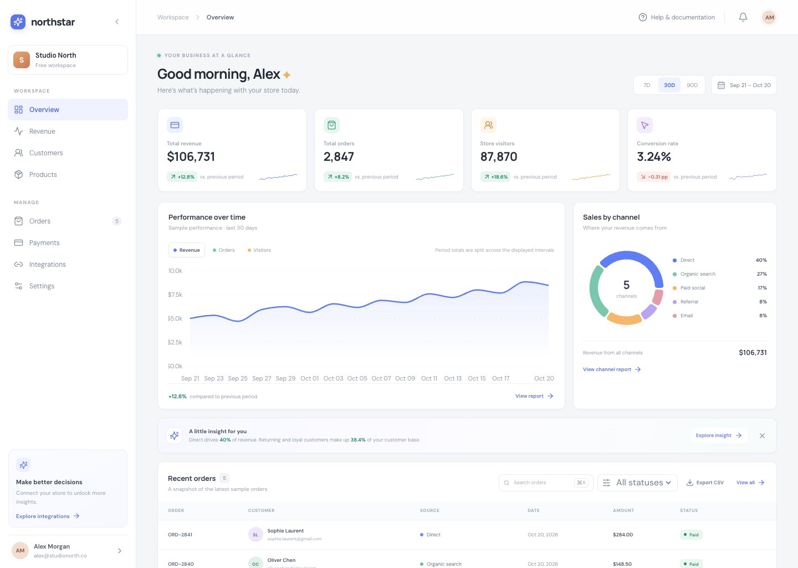

# Northstar Analytics

**A clear view of what is moving your business forward.**

Northstar is a responsive analytics dashboard demo built to make everyday business data easy to scan. It brings performance metrics, revenue trends, sales channels, and recent orders together in one calm workspace.

> All balances, customers, and order details in this demo are fictional sample data. No backend or external account connection is required.

## Preview



Live demo: https://iamzhangjinpeng.github.io/northstar-analytics-dashboard/

## What you can explore

- **Performance at a glance:** revenue, order volume, store visitors, and conversion rate with comparison indicators.
- **Interactive trend chart:** switch between revenue, orders, and visitors; explore 7, 30, or 90 day ranges; hover for exact values.
- **Channel mix:** a responsive Recharts doughnut chart with channel shares and revenue totals.
- **Recent orders:** search the sample orders and review customer, source, amount, and status details.
- **CSV export:** download the currently visible orders for a spreadsheet workflow.
- **Dedicated workspace pages:** browse Revenue, Customers, Products, Orders, Payments, Settings, and Integrations from the sidebar. Each page has its own route and supports browser back/forward navigation.
- **Responsive layout:** a compact, mobile-friendly navigation and stacked dashboard panels on smaller screens.

## Run locally

Requires Node.js 22 or newer and npm.

```bash
npm ci
npm run dev
```

Vite prints the local address. To create and preview a production build:

```bash
npm run build
npm run preview
```

## Tech stack

| Area | Technology |
| --- | --- |
| UI | React + TypeScript |
| Build | Vite |
| Charts | Recharts |
| Icons | Lucide React |
| Styling | Responsive CSS with design tokens |
| Data | Local fictional sample data |

## Deploy

The current public demo is hosted on GitHub Pages: https://iamzhangjinpeng.github.io/northstar-analytics-dashboard/. Each push to `main` triggers GitHub Actions to build the dashboard and publish `dist/`.

`vercel.json` includes the SPA fallback for an optional Vercel deployment. This repository is not currently deployed on Vercel; if you set up a preview there, use `npm run build` with `dist` as the output directory.

The GitHub Pages build also publishes a fallback page so shared links to routes such as `/orders` or `/revenue` open the dashboard directly.

## Project structure

```text
src/
  App.tsx             Dashboard shell, navigation, and overview
  secondary-pages.tsx Revenue, customers, products, orders, payments, settings, and integrations
  data.ts             Typed sample metrics, channels, and orders
  styles.css          Responsive visual system
  main.tsx            React entry point and browser router
```
